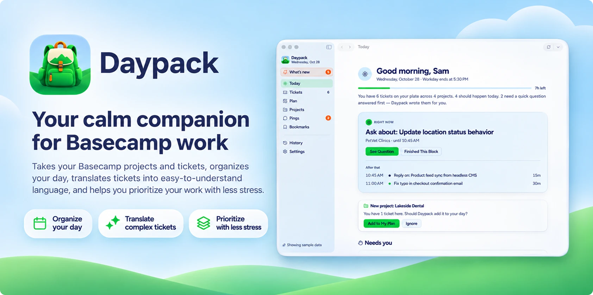

Daypack is a native Mac app for people who get their work from Basecamp. Every
morning it gathers what's assigned to you, explains each ticket in plain
English, points out what to ask before you start, and lays out a realistic plan
for your day. Then it lets you do the work itself (comment, check things off,
move cards, chat with your team) without living in a browser tab.

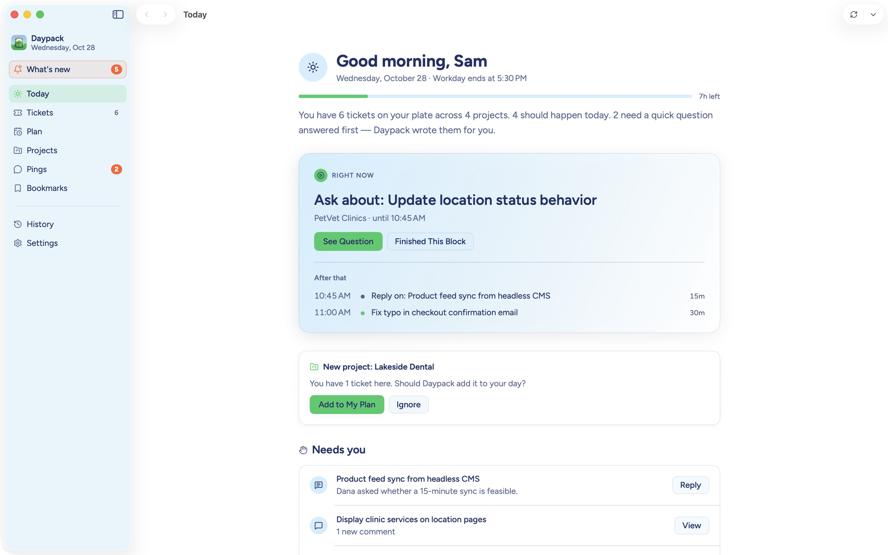

**[Download Daypack for Mac](https://github.com/jeffcalaway/daypack/releases/latest)**
· macOS 15 Sequoia or later · Works with any Basecamp account

Every screenshot here uses made-up sample data. You can explore the same
sample data yourself before connecting Basecamp.

---

## At a glance

- **A plan for your day**, ready when you sit down, built around your meetings
  and working hours.
- **Every ticket in plain English**: what's being asked, what you'll need to do,
  and how you'll know it's done, even when the real answer is buried in
  comment #14.
- **The right question, already written**: when something is unclear, Daypack
  drafts the follow-up and tags the right people. You edit it and post it.
- **A step-by-step build guide** that can look at your code (read-only).
- **Ask anything** about a ticket or your day, and get answers that point back
  to their source.
- **Work in Basecamp from Daypack**: comments, to-dos, cards, card tables,
  messages, docs, Campfire chats and Pings.
- **Private by design**: your data stays on your Mac, AI is optional, and you
  decide exactly what it may see.

---

## Start your day knowing what to do

**Today** is your home base. In the morning it greets you with a plan that's
already made. During the day it shows what to work on *right now* and what's
next. In the evening it helps you wrap up, and anything unfinished rolls into
tomorrow.

Below that, **Needs you** collects the few things that actually need your
attention: a client waiting on a reply, a new comment on something you're
building, a new project that might belong on your plate.

## Every ticket, explained

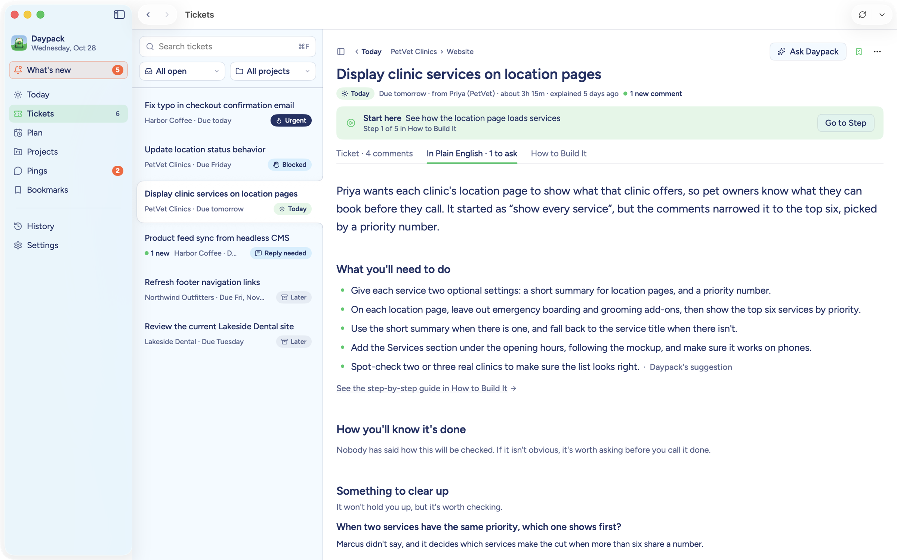

Long Basecamp threads are hard to read. Requirements change halfway down, and
decisions hide in replies. **In Plain English** reads the whole ticket, comments
included, and tells you:

- what's being asked and why it's on your plate,
- what you'll need to do, as a short checklist,
- how you'll know it's done,
- what changed since you last looked.

Every point comes from the ticket itself, and anything Daypack suggested on its
own is labeled as its suggestion. If it got something wrong, correct it. Your
correction is kept and used every time the ticket is read again.

## Ask the right question before you start

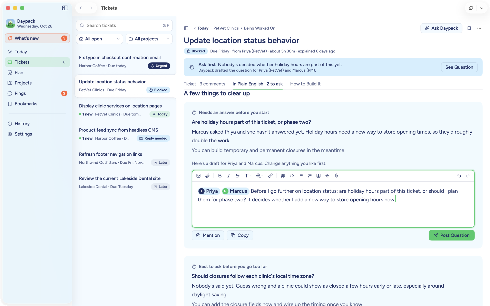

When something important hasn't been decided, Daypack spots it before you
build the wrong thing. It explains why the answer matters, suggests what you
can safely start on in the meantime, and **drafts the question for you**, with
the right people already @mentioned. Change anything you like, then press
**Post Question**. Nothing is ever posted without you.

## A plan for building it

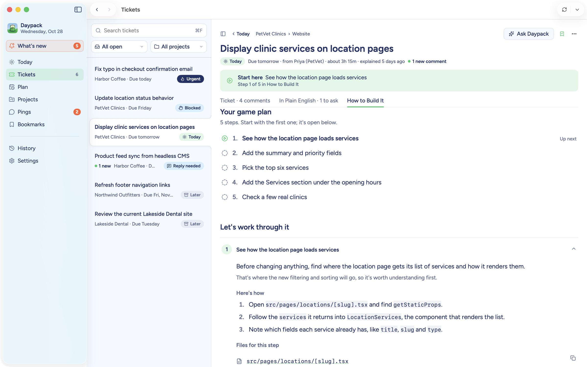

**How to Build It** turns a ticket into a game plan: the overall approach, the
steps in order, and the files to start in. Connect a project's code folder and
the guide gets specific, naming real files and components. Daypack opens your
code **read-only**. It never edits files, runs scripts or touches Git, and
anything that looks like a password or key is skipped.

## Ask anything

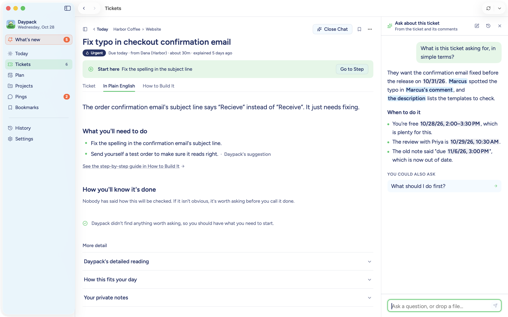

Not sure what a client meant? Press **Ask Daypack** and ask in your own words.
Highlight a sentence, right-click an image, comment or attachment, or drop in a
file to ask about that part. Answers link back to the comment, the person or
the date they came from, and earlier conversations are saved with the ticket.

## A realistic plan for your day

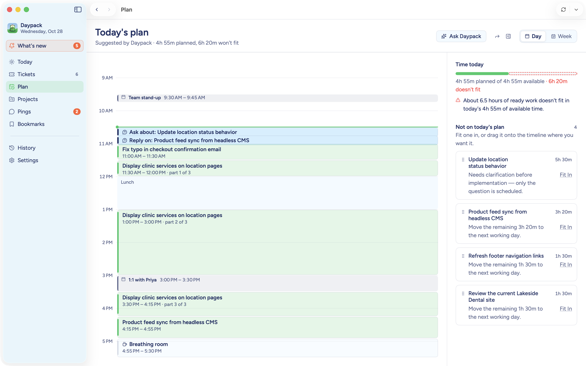

**Plan** lays your tickets out on a timeline around your meetings, lunch and
working hours, splitting bigger work into focus blocks. It's honest about time:
if there's more work than day, it says so and suggests what can move to
tomorrow. Drag blocks to change the order, drop waiting work onto any free
time, switch to the week view, or pin a block so it stays put. Daypack reads
your Mac's calendars to find your meetings and never changes them.

## Just say what you want

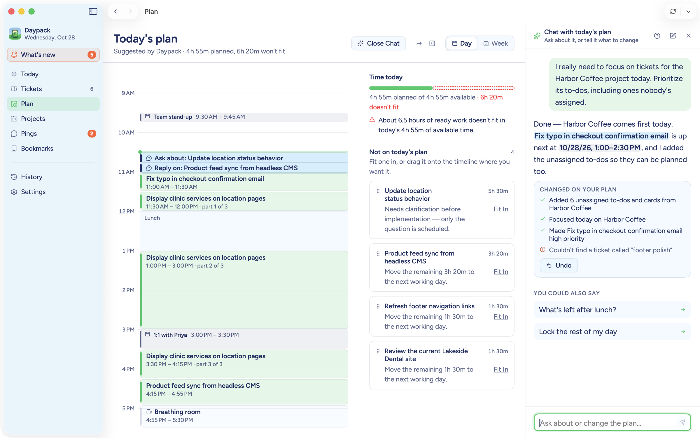

Tell the plan what you need: *"I really need to focus on Harbor Coffee today"*
or *"What's left after lunch?"*. Daypack changes your plan, lists exactly what
it did, and gives you **Undo**. It can only rearrange your own plan. It never
changes anything in Basecamp.

## Work on tickets without switching apps

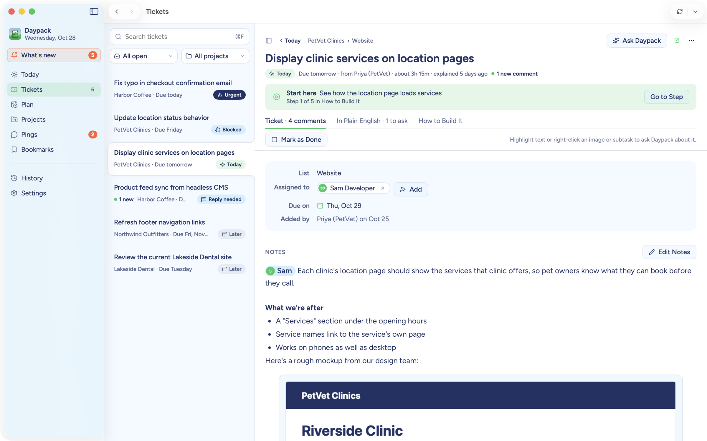

The **Ticket** tab shows a to-do or card the way Basecamp does, and nearly
everything is editable: assignees, due dates, notes, steps, comments with
@mentions, boosts, and **Mark as Done**. The editor works like Basecamp's, with
images, files, galleries, tables, colors, links and dictation.

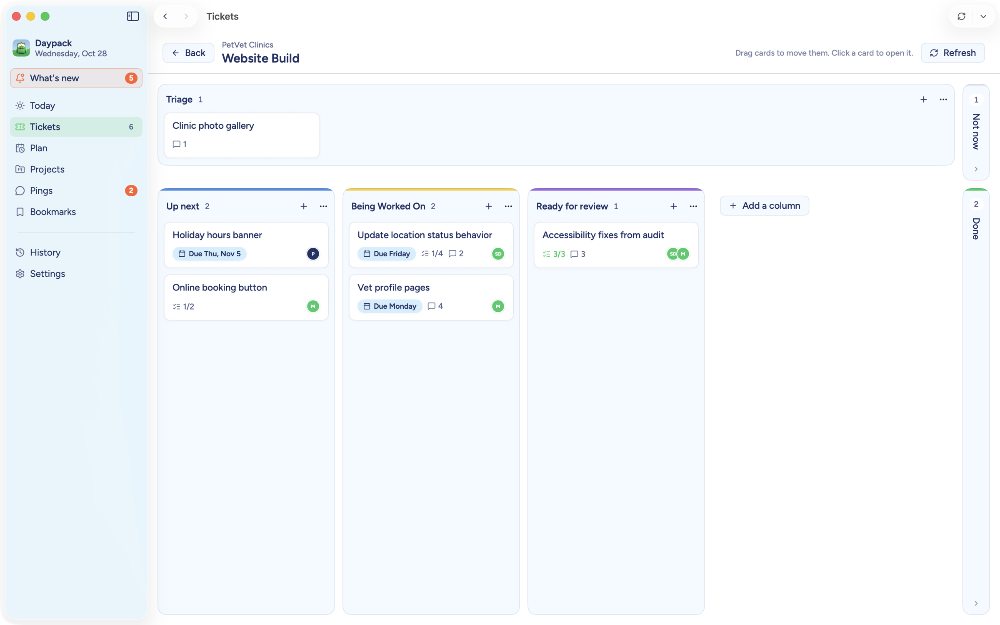

**Card tables** work as you'd expect: drag cards between columns, add cards and
columns, and rename, recolor or reorder columns.

Daypack changes Basecamp **only when you press a button**: never on a schedule,
and never because an AI suggested it.

## All your projects in one place

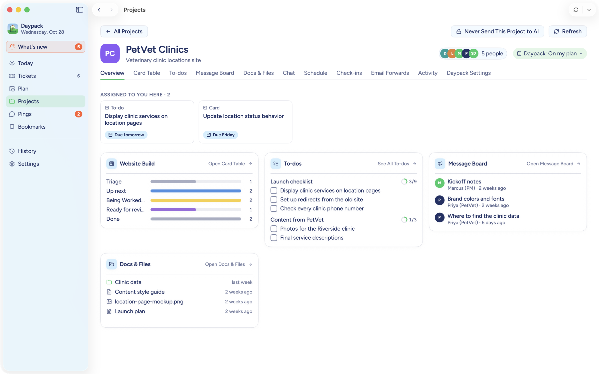

Each project gets a page like its Basecamp home: what's assigned to you there,
and every tool at a glance. Open the **card table**, check off and add
**to-dos**, read and post on the **message board**, write **docs** and upload
**files**, see the **schedule**, answer **check-ins**, and follow the
project's **activity**.

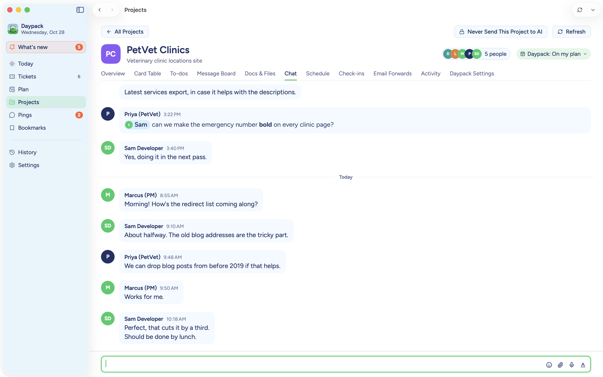

Keep up with the project's **Campfire** chat right next to your work.

## Pings, bookmarks and what's new

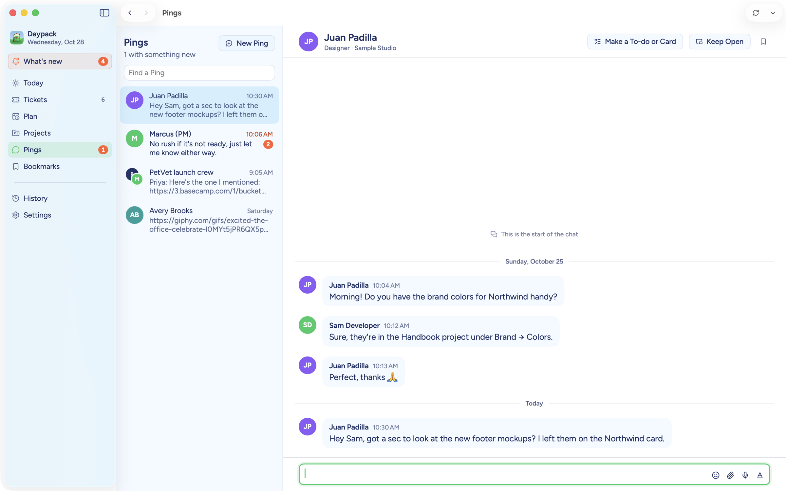

Read and reply to **Pings**, keep a conversation floating over your work, or
turn any message into a to-do or card in one click. **What's new** gathers
mentions, replies and changes on your tickets since you last looked, and
**Bookmarks** keeps the cards, to-dos, docs and conversations you want to come
back to.

## Quietly working in the background

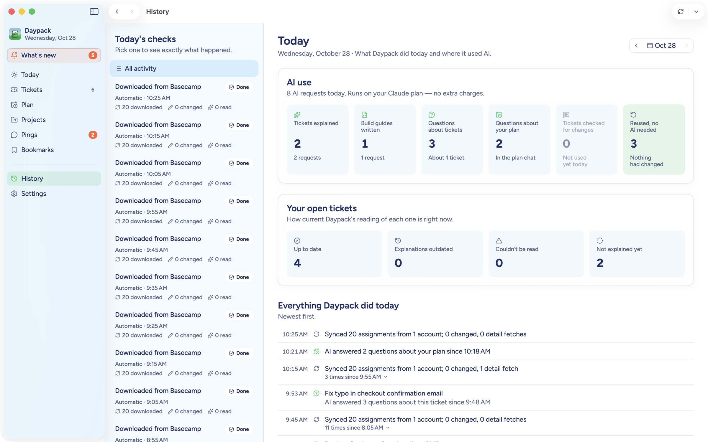

Daypack checks Basecamp for you at set times, so your plan is ready before you
are. If your Mac was asleep, it catches up when you wake it. The **menu bar**
shows what's now, what's next and what's left, and **notifications** tell you
when your plan is ready or a ticket's requirements change.

**History** shows exactly what Daypack did and when, and where it used AI. AI
results are reused whenever nothing changed, so you're not paying twice for the
same answer.

## Choose your AI, or none at all

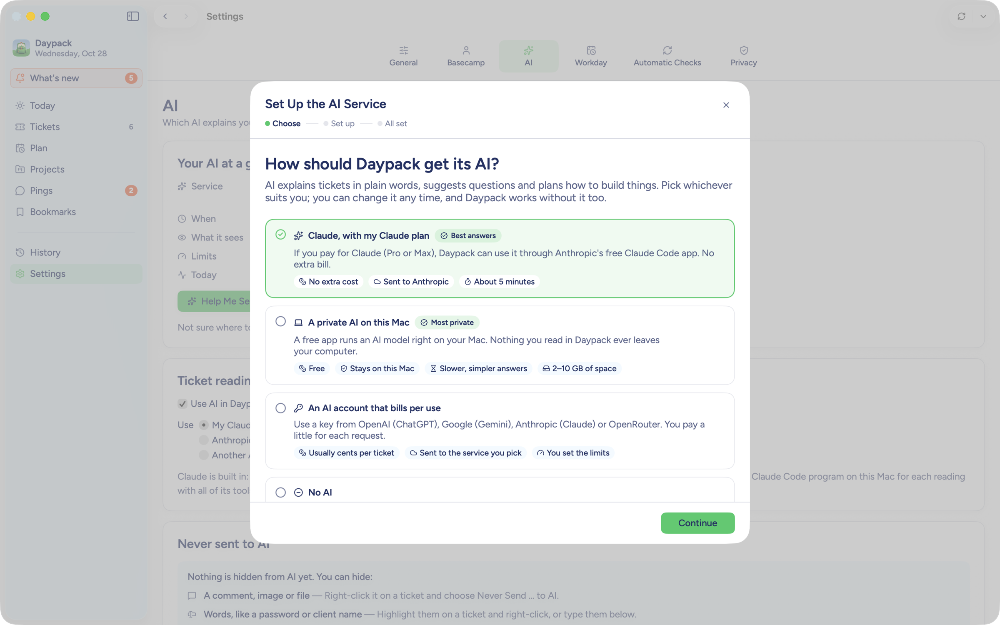

A short setup guide walks you through it:

- **Claude, with your Claude plan.** If you pay for Claude (Pro or Max),
  Daypack uses it through Anthropic's free Claude Code app, at no extra cost.
- **A private AI on this Mac**, through Ollama or LM Studio. Nothing leaves your
  computer.
- **An AI account that bills per use**: OpenAI (ChatGPT), Google (Gemini),
  Anthropic or OpenRouter.
- **No AI.** Daypack still syncs, plans and lets you work on tickets.

You also choose **when** AI runs (only when you press a button, or
automatically), per feature and per project.

## Privacy you can see

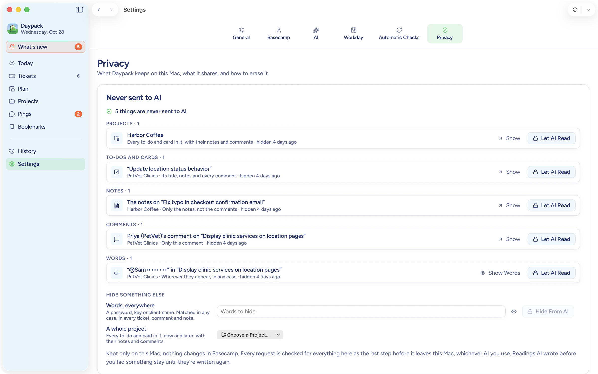

- **Your data stays on your Mac**, in an encrypted database, inside an app
  sandboxed by macOS. No accounts, no telemetry, no analytics.
- **AI sees only what one request needs**, sent only to the AI you chose.
  Passwords, keys, card numbers and similar are removed first, and people are
  named by first name at most.
- **Mark anything "never send to AI"**: a whole project, a ticket, a comment, a
  file, or words like a client's name, wherever they appear.
- **Ask before sending**: a confidential project can require your OK before
  anything about it goes to AI.
- **Clean up whenever you like**: saved AI results expire after 90 days by
  default, and you can clear them, or delete everything, with one click.
- Basecamp sign-ins and AI keys live in your Mac's Keychain.

---

## Getting started

1. From the [latest release](https://github.com/jeffcalaway/daypack/releases/latest),
   download **Daypack-x.y.z.dmg** (under *Assets*).
2. Open the DMG and drag **Daypack** into your **Applications** folder.
3. Open Daypack from Applications. The first time, macOS asks you to confirm
   (see [below](#opening-daypack-the-first-time)).
4. Choose **Sign In with Basecamp**, or **Explore with sample data first** to
   look around with made-up data.
5. Pick which projects belong on your plan, set your working hours, and choose
   an AI (or none). It takes a few minutes, and you can change everything later.

### Opening Daypack the first time

Daypack isn't notarized by Apple yet, so the first time you open it macOS says
it can't check Daypack for malicious software. To open it anyway:

1. Open Daypack once and click **Done** on the warning.
2. Open **System Settings → Privacy & Security** and scroll down to
   *Security*.
3. Next to "Daypack was blocked to protect your Mac", click **Open Anyway**,
   then confirm with your password or Touch ID.

You only do this once. Updates open normally.

### Staying up to date

Daypack checks for updates once a day. When one is ready, an **orange dot**
appears on the backpack in the menu bar; right-click it and choose **Install
Update…**. Turn on **Update Automatically** in the same menu to have updates
download on their own and install the next time you quit.

## Requirements

- macOS 15 Sequoia or later
- A Basecamp account
- Optional, for AI help: a Claude Pro or Max plan with the free
  [Claude Code](https://claude.com/claude-code) app, a private AI on your Mac
  (Ollama or LM Studio), or an account with an AI service

## Handy shortcuts

| Shortcut | What it does |
| --- | --- |
| **⌘R** | Get the latest from Basecamp for whatever you're looking at |
| **⇧⌘R** | Get the latest, and have AI read what changed |
| **⌘F** | Search your tickets |
| **⌘[** / **⌘]** | Go back and forward |

## Questions

**Will Daypack change anything in Basecamp on its own?**
No. It changes Basecamp only when you press a button: Post, Mark as Done,
dragging a card, and so on. AI suggestions are only ever text you can edit.

**Do I need AI?**
No. Without AI, Daypack still syncs your work, plans your day and lets you work
on tickets. AI adds the plain-English readings, drafted questions, build guides
and chat.

**Does it cost anything to use AI?**
With a Claude plan it uses what you already pay for. A private AI on your Mac is
free. A pay-per-use service bills you directly, usually cents per ticket. Either
way, you can cap how many AI requests Daypack makes each day.

**Light or dark?**
Both. Daypack follows your Mac, or you can pick one in Settings → General.

---

This repository hosts Daypack's releases and update feed (`appcast.xml`). The
source code is developed privately. Please report security issues privately
rather than in a public issue.
